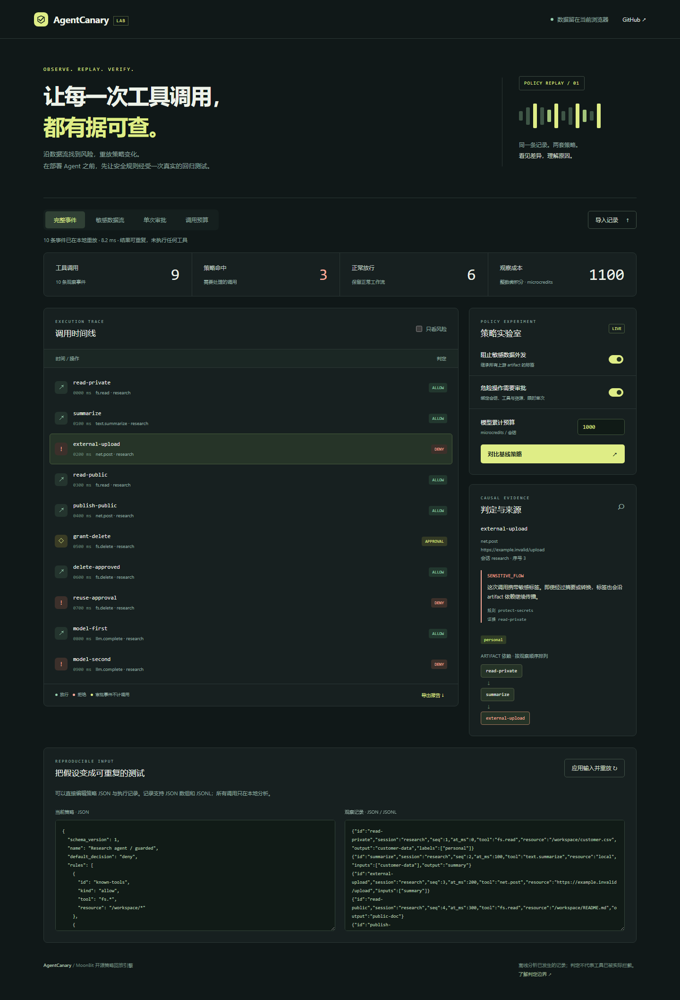

# AgentCanary

[](https://github.com/zhangbowen2006/AgentCanary/actions/workflows/ci.yml)
[](https://mooncakes.io/docs/zhangbowen2006/agentcanary)

**AI 工具调用的离线策略回放与回归测试引擎。** 核心使用 MoonBit，无第三方 Mooncakes 依赖，同一套逻辑运行于 Wasm、Wasm GC、JavaScript 和 Native 后端。

一份客户资料被读取、摘要、再上传：只检查上传调用本身，看不到资料来自哪里。AgentCanary 沿显式 artifact 依赖传播敏感标签，给出来源事件；同时检查审批复用、累计费用、窗口频率和前置步骤。策略升级时，对同一观察记录比较两套策略，确认新增拦截与误拦风险。

[在线实验室](https://zhangbowen2006.github.io/AgentCanary/) · [English](README.en.md) · [严格语义](docs/SEMANTICS.md) · [输入格式](docs/FORMAT.md) · [可执行 API 示例](API.mbt.md) · [参赛申报书](docs/PROPOSAL.md)



## 五分钟运行

安装 [MoonBit 工具链](https://www.moonbitlang.com/download/)；CLI 和浏览器演示还需 Node.js 22 或更高版本。无需 npm install、API Key、模型或云服务。

```sh
git clone https://github.com/zhangbowen2006/AgentCanary.git
cd AgentCanary
moon check --deny-warn
moon test --deny-warn
moon run cmd/demo
node scripts/build.mjs
node bin/agentcanary.mjs audit --policy examples/policy.json --trace examples/incident.jsonl
node bin/agentcanary.mjs test examples/regressions.json
node scripts/serve.mjs
```

打开 `http://127.0.0.1:4173`。演示提供三类风险、时间线、来源链、策略开关、预算调整、基线对比、JSON 编辑、记录导入和报告导出；导入内容只在当前浏览器处理。开始运行后不需要外部网络。

样例共 10 条观察事件、9 次工具调用：6 次放行、3 次拒绝。拒绝分别为敏感数据外发、单次审批复用、模型累计成本 1100 超过 1000。公开资料发布仍放行。全部样例均为人工构造的虚构记录，未执行实际删除或上传。

## 在 MoonBit 项目中复用

```sh
moon add zhangbowen2006/agentcanary@0.1.0
```

在调用包的 `moon.pkg` 中添加：

```moonbit
import {
  "zhangbowen2006/agentcanary" @canary,
}
```

通过 `parse_policy`、`parse_trace`、`evaluate`、`compare`、`run_suite` 获得类型化结果；字符串接口为 `evaluate_json`、`compare_json`、`run_suite_json`。具体示例在 [API.mbt.md](API.mbt.md)，这些示例也参与编译和测试。生成的 [pkg.generated.mbti](pkg.generated.mbti) 列出完整公共 API。

## 用作回归门禁

```sh
# 有拒绝判定时退出 1；普通 audit 默认只生成报告。
node bin/agentcanary.mjs audit --policy examples/policy.json --trace examples/incident.jsonl --fail-on-deny

# 策略收紧导致新增拒绝时退出 1；也可以使用 --fail-on-new-allow。
node bin/agentcanary.mjs compare --baseline examples/baseline.json --candidate examples/policy.json --trace examples/incident.jsonl --fail-on-new-deny

# 自包含用例集：每个调用均需断言判定和完整的违规码集合。
node bin/agentcanary.mjs test examples/regressions.json --format json
```

`audit` 和 `compare` 的 JSONL 记录可用 `--trace -` 从 stdin 输入。三条命令均支持 `--format json|text`。退出码：0 通过，1 门禁或用例不通过，2 输入、文件或环境错误。

## 规则与边界

| 规则 | 作用 |
| --- | --- |
| `allow` / `deny` | 工具和资源的锚定 glob 匹配；deny 优先 |
| `block_labels` | 检查本次声明和上游继承的敏感标签，附来源事件 |
| `require_approval` | 同会话、精确工具和资源、到期失效、单次使用、可撤销 |
| `budget` | 每会话累计或滑动窗口的整数微积分预算 |
| `rate` | 每会话滑动窗口内的调用次数 |
| `require_before` | 在本会话及可选窗口内已成功完成的前置工具 |

这是对**已观察历史**的离线分析。被策略判为拒绝的历史调用仍参与费用和数据流计算；比较结果不模拟拦截之后 Agent 会产生的全新行为。采集器必须真实、完整地记录 artifact 依赖与敏感标签，并独立认证审批来源。引擎不执行工具，不检测自然语言提示注入，不推断未标注的敏感内容，也不提供操作系统沙箱。详见 [语义与信任边界](docs/SEMANTICS.md)。

报告默认省略资源路径，不接受任意原始 payload 字段；事件 ID、工具名和标签仍可能包含调用方写入的信息，公开报告前应自行审查。

## 验证与工程证据

```sh
moon check --target all --deny-warn
moon test --target all --deny-warn
moon build --target all --deny-warn
moon fmt --check
moon info
node scripts/build.mjs
node --test tests/cli.test.mjs
node scripts/benchmark.mjs
```

Native 需要系统 C 编译环境；Windows 用户可用 MSVC Developer PowerShell。只使用浏览器、CLI 或默认 Wasm GC 后端无需 C 编译器。[CI](.github/workflows/ci.yml) 在 Linux、macOS、Windows 检查全部四个后端，并验证生成接口、CLI 和回归用例。[基准说明](docs/BENCHMARK.md) 记录测量方法及限制，不将本机数据泛化为所有平台性能保证。

项目为 `zhangbowen2006` 的十月独立新项目；无既有参赛项目核心代码复用、无开源项目移植。核心、测试、合成样例和演示有 AI 辅助，范围、来源、技术解释和维护事项见 [PROVENANCE.md](docs/PROVENANCE.md)。许可证：[MIT](LICENSE)。
