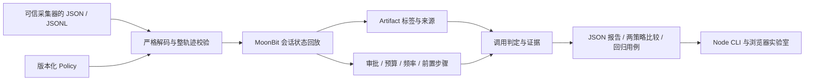

# 架构与扩展

根包拥有所有公共类型和规则语义。`decode.mbt` 解码；`json_guard.mbt` 在标准 JSON 解析前限制嵌套，并在解析后检查解码键的唯一性；`validate.mbt` 检查跨事件约束；`matching.mbt` 实现非递归 glob；`lineage.mbt` 合并标签和来源；`replay.mbt` 按会话维护状态；`compare.mbt` 对同一观察进行两次独立评估；`suite.mbt` 执行完整断言覆盖的回归用例。

审批表、artifact 表、窗口账本和最近成功前置步骤均按会话键隔离。窗口账本维护头索引和 Int64 合计，每笔 charge 只加入/移出一次，避免每次重算完整历史。前置步骤每规则只保留最近成功匹配，不回扫历史。glob 使用贪心回溯、常数辅助空间；最坏情况下仍可与 pattern × value 长度成比例，不宣称严格线性时间。

状态仅存在于一次 evaluate 调用内，不修改输入数组/事件。所有输出顺序确定。标签来源数组按首次观察顺序去重，受显式标签/来源上限约束。禁止覆盖 artifact 是防止来源被后续调用悄悄替换的关键不变量。

`api/` 只处理公开 JSON 函数与结构化错误的桥接，导出 ESM。`bin/` 负责文件、stdin、格式和退出码；`web/` 负责呈现和交互。Node/浏览器不重新实现策略算法。JS 的 JSON 解析仅用于报告/编辑器呈现，最终判定仍经过 MoonBit 的严格输入验证。

扩展一个新规则时应同时更新：字段契约、解码校验、程序化构造校验、序列化、回放、独立边界测试、文档和示例；不要在 UI 中实现仅对演示有效的判定。
